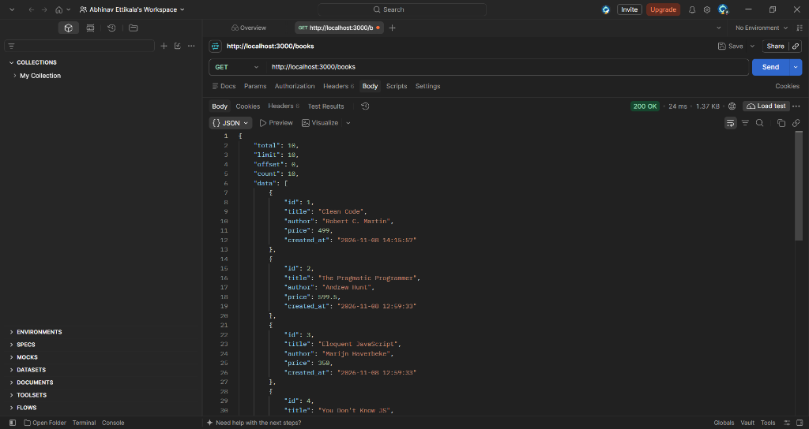
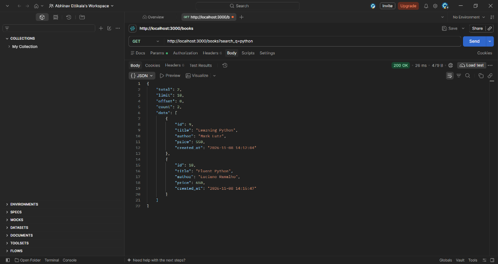
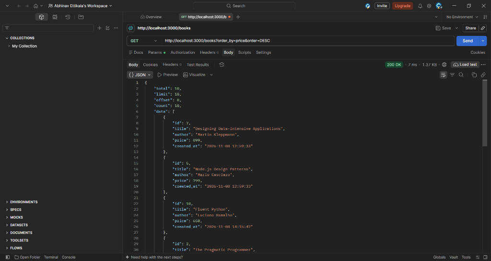
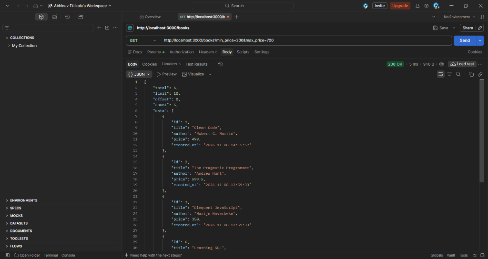
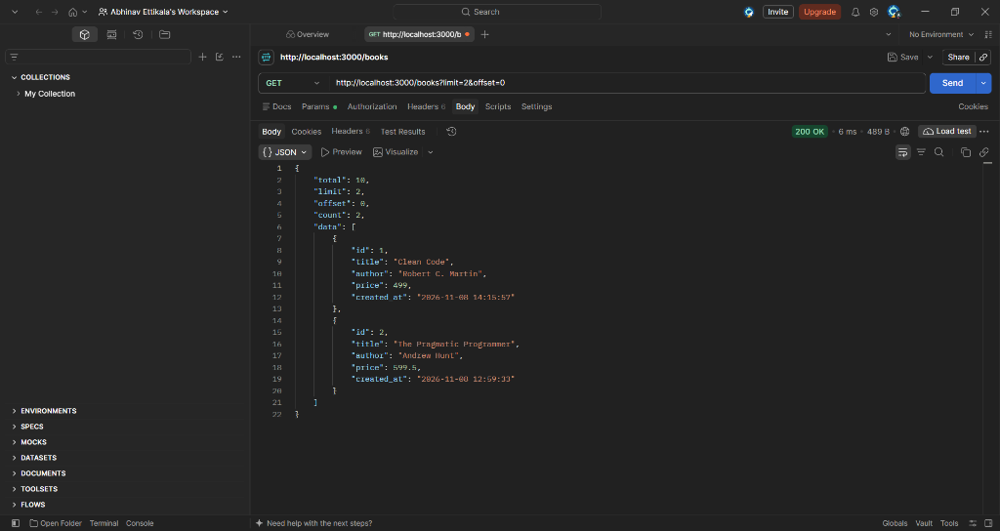
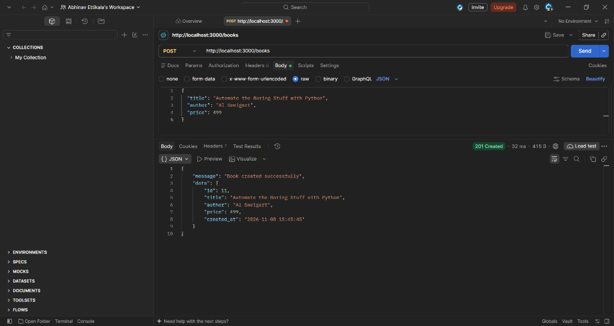
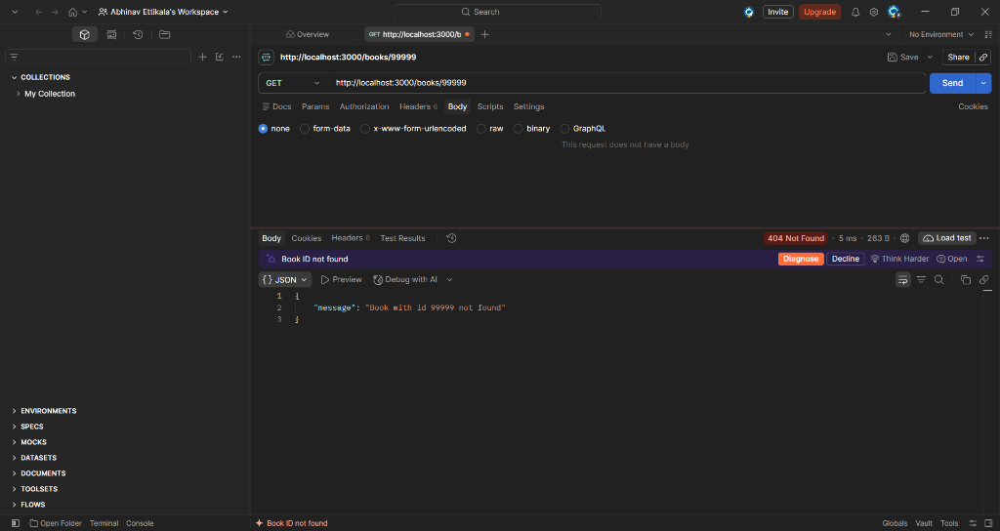
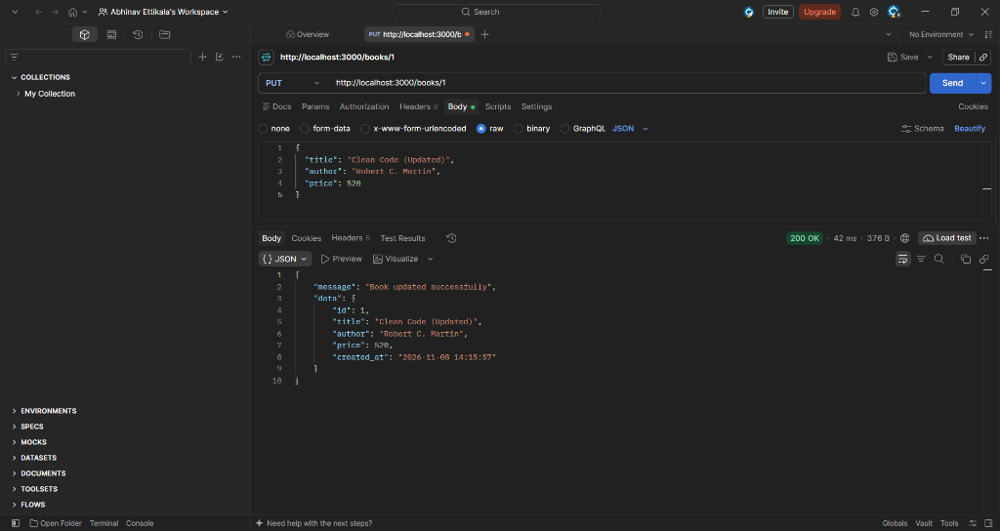
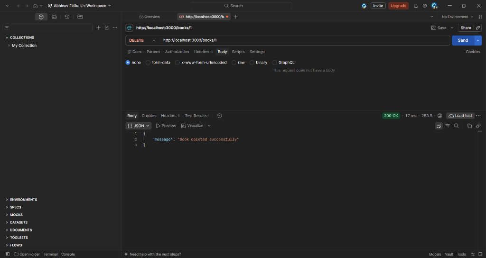
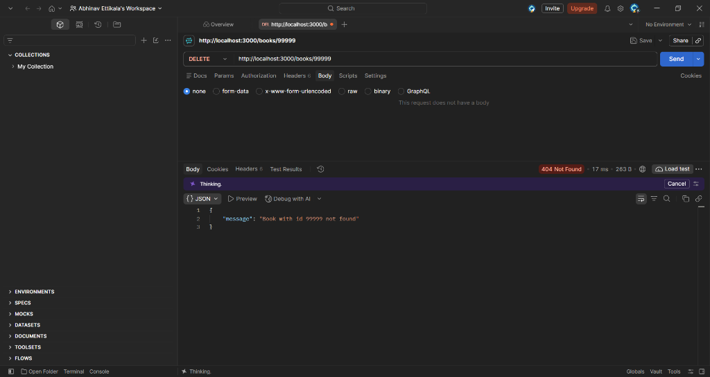

# Lab 3: REST API, query parameters, validation, debugging

**Name:** ETTIKALA ABHINAV · **Registration number:** 252U1R6065 · **Section:** YOUR SECTION

**Live link:** https://YOUR-SERVICE.onrender.com  *(replace after deploying; see "Deploy" below)*

**Repository:** https://github.com/abhinavettikala-cloud/Backend-Development-Fundamentals/tree/main/Lab-3

A books REST API built with Node.js, Express and SQLite. Supports search, sorting, price filters,
pagination, request validation, consistent JSON responses and correct HTTP status codes.

## How to run

```bash
cd Lab-3
npm install
cp .env.example .env        # Windows: copy .env.example .env
npm run seed                # optional: insert sample books
npm start                   # http://localhost:3000
npm test                    # unit tests for validation + SQL building
```

| Variable        | Purpose                                         | Example            |
|-----------------|-------------------------------------------------|--------------------|
| `PORT`          | Port to listen on (hosts set this automatically) | `3000`             |
| `DB_PATH`       | SQLite file location                            | `./data/books.db`  |
| `SEED_ON_START` | Insert sample books if the table is empty       | `true`             |

## Endpoints

| Method | Path          | Description                                              | Success | Errors        |
|--------|---------------|----------------------------------------------------------|---------|---------------|
| GET    | `/health`     | Health check                                             | 200     |               |
| GET    | `/books`      | List books with search, filters, sorting, pagination     | 200     | 400           |
| GET    | `/books/:id`  | Get one book                                             | 200     | 400, 404      |
| POST   | `/books`      | Create a book (`title`, `author`, `price`)               | 201     | 400           |
| PUT    | `/books/:id`  | Update a book (all three fields)                         | 200     | 400, 404      |
| DELETE | `/books/:id`  | Delete a book                                            | 200     | 400, 404      |

### Query parameters for `GET /books`

| Parameter   | Default | Rule                                                        |
|-------------|---------|-------------------------------------------------------------|
| `search_q`  | none    | Partial, case-insensitive title match using `LIKE`          |
| `order_by`  | `id`    | One of `id`, `title`, `author`, `price`                     |
| `order`     | `ASC`   | `ASC` or `DESC`                                             |
| `limit`     | `10`    | Integer 1 to 100                                            |
| `offset`    | `0`     | Integer 0 or more                                           |
| `min_price` | none    | Number; used with `max_price` it becomes `BETWEEN`          |
| `max_price` | none    | Number; must not be less than `min_price`                   |

Example: `GET /books?search_q=java&min_price=200&max_price=600&order_by=price&order=DESC&limit=5`

### Response format

```jsonc
// list
{ "total": 8, "limit": 10, "offset": 0, "count": 8, "data": [ { "id": 1, "title": "...", "author": "...", "price": 499, "created_at": "..." } ] }
// create / update
{ "message": "Book created successfully", "data": { ... } }
// delete
{ "message": "Book deleted successfully" }
// every error
{ "message": "price must be a number" }
```

## Postman test list

Import `postman/Lab3_Books_API.postman_collection.json` (set `baseUrl` to localhost or your live URL).
Every request has an automatic status-code test.

| # | Case | Expected |
|---|------|----------|
| 1 | List books (defaults) | 200 |
| 2 | `search_q=javascript` | 200 |
| 3 | `order_by=price&order=DESC` | 200 |
| 4 | `min_price=300&max_price=600` | 200 |
| 5 | `limit=3&offset=3` | 200 |
| 6 | POST valid book | 201 |
| 7 | GET by id / PUT valid / DELETE | 200 |
| 8 | POST missing title / author / price | 400 |
| 9 | POST non-numeric or negative price | 400 |
| 10 | POST malformed JSON | 400 |
| 11 | GET `/books/abc` | 400 |
| 12 | GET / PUT / DELETE unknown id | 404 |
| 13 | Invalid `order_by`, `order`, `limit`, `offset` | 400 |
| 14 | `min_price` greater than `max_price` | 400 |
| 15 | Unknown route | 404 |

## Screenshots

### 1. List All Books (`GET /books`)
- **Request:** `GET http://localhost:3000/books`
- **Status:** `200 OK`
- **Description:** Verifies default retrieval of all book records along with metadata (`total`, `limit`, `offset`, and `count`).


### 2. Search Books by Title (`GET /books?search_q=python`)
- **Request:** `GET http://localhost:3000/books?search_q=python`
- **Status:** `200 OK`
- **Description:** Verifies partial title search. Returns books whose titles contain "python" (`Learning Python`, `Fluent Python`).


### 3. Sort Books by Price Descending (`GET /books?order_by=price&order=DESC`)
- **Request:** `GET http://localhost:3000/books?order_by=price&order=DESC`
- **Status:** `200 OK`
- **Description:** Verifies sorting by price in descending order. Highest priced books (e.g. 899, 799, 650) appear first.


### 4. Filter Books by Price Range (`GET /books?min_price=300&max_price=700`)
- **Request:** `GET http://localhost:3000/books?min_price=300&max_price=700`
- **Status:** `200 OK`
- **Description:** Verifies price range filtering. Returns only records with prices between 300 and 700 inclusive.


### 5. Pagination with Limit and Offset (`GET /books?limit=2&offset=0`)
- **Request:** `GET http://localhost:3000/books?limit=2&offset=0`
- **Status:** `200 OK`
- **Description:** Verifies pagination controls. Requesting `limit=2&offset=0` returns at most two records while reporting total books available.


### 6. Create Book with Valid JSON (`POST /books`)
- **Request:** `POST http://localhost:3000/books`
- **Status:** `201 Created`
- **Description:** Verifies creation of a new book record with valid payload (`title`, `author`, `price`). Returns the newly created book object with auto-generated `id`.


### 7. Validation Error on Negative Price (`POST /books`)
- **Request:** `POST http://localhost:3000/books`
- **Status:** `400 Bad Request`
- **Description:** Verifies validation error handling when sending invalid data (`"price": -50`). Returns clear error message: `"price must not be negative"`.


### 8. Non-existent Book ID (`GET /books/99999`)
- **Request:** `GET http://localhost:3000/books/99999`
- **Status:** `404 Not Found`
- **Description:** Verifies 404 response when querying a book ID that does not exist in the database. Returns `"Book with id 99999 not found"`.


### 9. Update Book by ID (`PUT /books/1`)
- **Request:** `PUT http://localhost:3000/books/1`
- **Status:** `200 OK`
- **Description:** Verifies updating an existing book record (`title`, `author`, `price`) by ID. Returns updated book details.


### 10. Delete Book by ID (`DELETE /books/1`)
- **Request:** `DELETE http://localhost:3000/books/1`
- **Status:** `200 OK`
- **Description:** Verifies deleting an existing record by ID. Returns success confirmation message `"Book deleted successfully"`.


### 11. Delete Non-existent Book ID (`DELETE /books/99999`)
- **Request:** `DELETE http://localhost:3000/books/99999`
- **Status:** `404 Not Found`
- **Description:** Verifies 404 response when attempting to delete a book ID that does not exist. Returns `"Book with id 99999 not found"`.


## Deploy

**Render (easiest):** push the repo to GitHub, then Render → New → Blueprint → select the repo.
`render.yaml` at the repo root already sets root directory `lab-03`, build `npm install`, start `npm start`
and health check `/health`. Or create a Web Service manually with those same values.

**Docker:** `cd Lab-3 && docker build -t lab3 . && docker run -p 3000:3000 lab3`

> SQLite is a file. On Render's free tier the disk is wiped on every deploy/restart, so data resets.
> `SEED_ON_START=true` re-inserts the sample books each time. For permanent data, attach a persistent disk
> and point `DB_PATH` at it, or move to a hosted database.

## Notes: problems faced and how I solved them

The four debugging-exercise errors and their fixes:

| Error | Cause | Fix |
|-------|-------|-----|
| `EADDRINUSE` | Another process already uses the port | Stop it (`lsof -i :3000` / `netstat -ano`) or change `PORT`. `server.js` prints a clear message. |
| `Cannot find module './...'` | Wrong relative import path | Check the path from the importing file's folder (`../utils/validators`, not `./utils/validators`). |
| `SQLITE_ERROR: no such table: book` | Typo in table name (table is `books`) | Use the same name as in `CREATE TABLE`. |
| Response is `{}` / `Promise { <pending> }` | Missing `await` on `db.get/all/run` | Add `await` and make the handler `async`. Errors are forwarded by the `wrap()` helper. |

Add your own notes here.


## Security notes

All SQL uses `?` placeholders. `order_by` and `order` are whitelisted because identifiers cannot be bound.
`%` and `_` in `search_q` are escaped. `.env` and `node_modules` are git-ignored.
