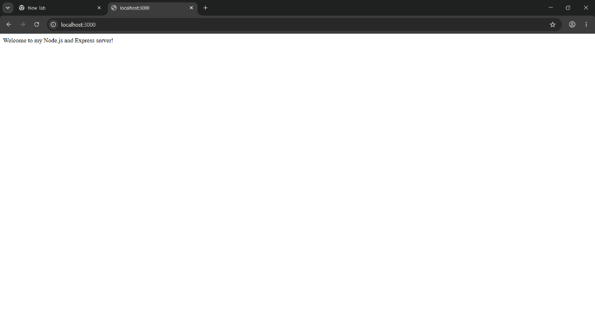
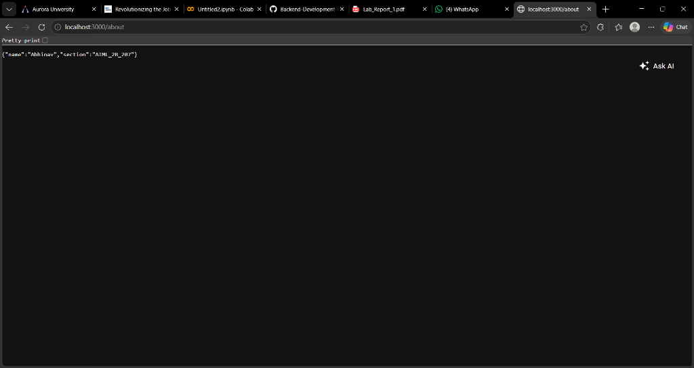
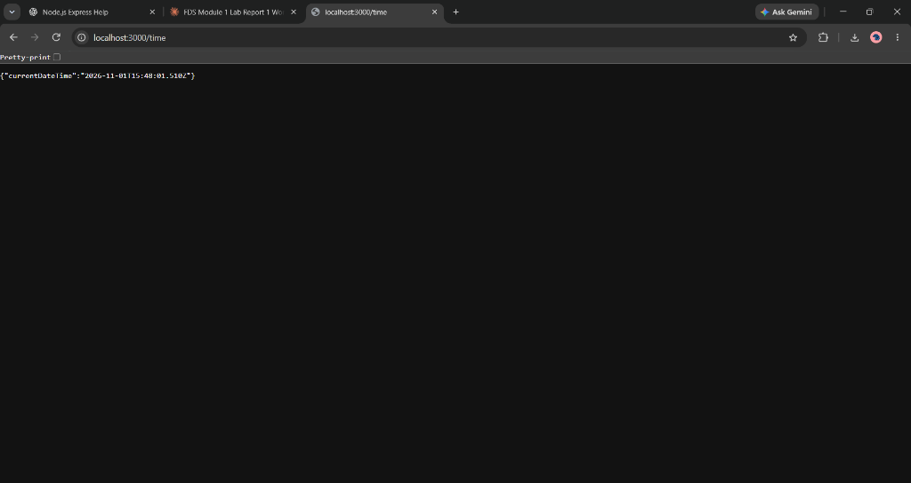
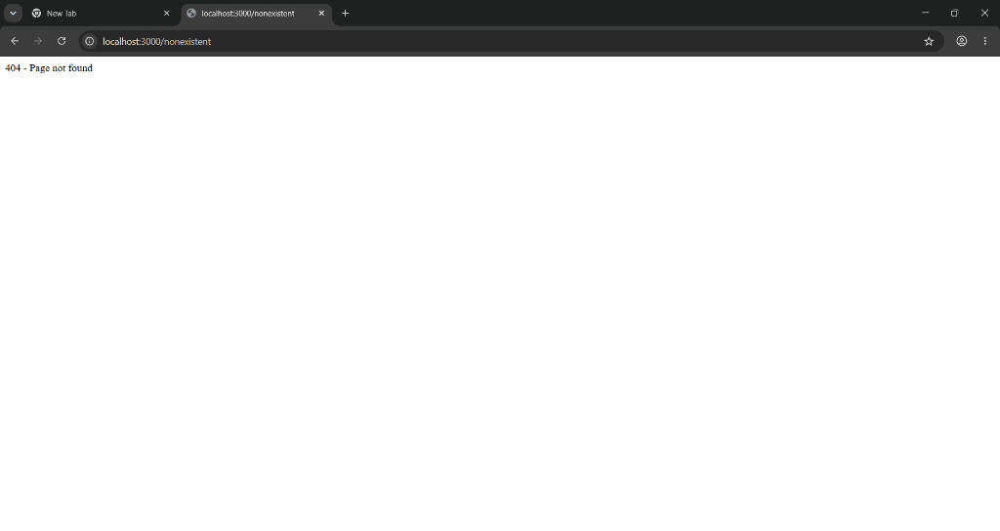

# Lab 1: Node.js and Express server

**Live link:** Pending deployment. Add the public server URL here before submission.

| Student detail | Value |
| --- | --- |
| Name | Abhinav |
| Registration number | 252U1R6065|
| Section | AIML_2B_207 |
| Course | Backend Development Fundamentals |

## Objective

Create a basic server using Node.js's built-in `http` module, then use Express to serve welcome text, student details, current date/time, and a custom 404 response.


## Install and run

Prerequisites: Node.js 22 or newer and npm.

From the course repository root:

```bash
cd lab-01
npm install
npm start
```

Open http://localhost:3000 in a browser. Use Ctrl+C to stop the server.

To run the plain Node.js server instead:

```bash
npm run start:http
```

It responds with `Hello` on port 3000. Stop one server before starting the other because both use port 3000 locally.

### Environment variables

No environment variables or secrets are required locally. The Express server optionally reads `PORT`, supplied by a deployment platform; otherwise it uses port 3000. The plain HTTP exercise always uses port 3000. No `.env` file is needed or loaded.

## Endpoints

These routes apply to the Express server:

| Method | Path | Description | Expected status |
| --- | --- | --- | --- |
| GET | `/` | Returns welcome text | 200 |
| GET | `/hello` | Returns hello text | 200 |
| GET | `/about` | Returns name and section as JSON | 200 |
| GET | `/time` | Returns the current date/time as JSON in ISO 8601 UTC format | 200 |
| GET | `/unknown` | Demonstrates the fallback for unknown paths | 404 |

The time changes with each request; the final `Z` indicates UTC. Any unmatched path reaches the 404 handler.

## Verify the output

1. Start the Express server using `npm start`.
2. Open `/`, `/about`, `/time`, and `/unknown` at http://localhost:3000.
3. In Chrome, press F12, select Network, refresh, and inspect the request's status code.
4. The server terminal also logs the method, path, and final status.
5. Capture screenshots showing the URL, output, and status where possible.

Expected request log:

```text
GET / -> 200
GET /about -> 200
GET /time -> 200
GET /unknown -> 404
```

## Screenshots






## Deployment configuration

Use a Node.js web-service host. When deploying the whole course repository, configure:

| Setting | Value |
| --- | --- |
| Project/root directory | `lab-01` |
| Build/install command | `npm ci` |
| Start command | `npm start` |
| Port | Hosting platform's `PORT` environment variable |

After deployment, verify all endpoints using the public URL and add that URL at the top of this README. GitHub stores the source code; GitHub Pages cannot run this Node.js server.

## Files

| File | Purpose |
| --- | --- |
| `http-server.js` | Plain Node.js HTTP server |
| `server.js` | Express routes, request logging, and 404 fallback |
| `package.json` | Project metadata, scripts, and dependency declarations |
| `package-lock.json` | Exact resolved dependency versions |
| `.gitignore` | Excludes dependencies, environment files, and logs |
| `screenshots/` | Place actual output screenshots here |

## package.json fields

| Field | Meaning |
| --- | --- |
| `name` | npm package/project name |
| `version` | Project version |
| `description` | Short project summary |
| `private` | Prevents accidental publication to npm |
| `main` | Entry point when importing the package; does not control npm start |
| `type` | CommonJS enables the require syntax used here |
| `scripts` | Named commands, including start and start:http |
| `author` | Project author |
| `license` | UNLICENSED means no public reuse license has been granted |
| `dependencies` | Packages required by the application |

Express is installed at `node_modules/express`. Do not commit `node_modules`; npm reinstalls it from the package files.

## Viva preparation

**What is the difference between package.json and node_modules?**
`package.json` describes the project and its dependencies. `node_modules` stores installed dependency code.

**What does app.listen do?**
It starts the HTTP server listening for connections on the specified port.

**What do request and response represent?**
`req` contains the client's incoming request information. `res` is used to set the response status and headers and send content back to the client.

**Why is the 404 handler last?**
Valid routes must get a chance to respond before the fallback handles unmatched requests.

## Notes: problems and solutions

Add problems you actually encountered and the fixes you used. Common troubleshooting:

- `EADDRINUSE`: stop the other server using Ctrl+C before starting this one.
- `Cannot find module 'express'`: run `npm install` inside `lab-01`.
- An incorrect section: edit `/about` in `server.js` and restart the server.

