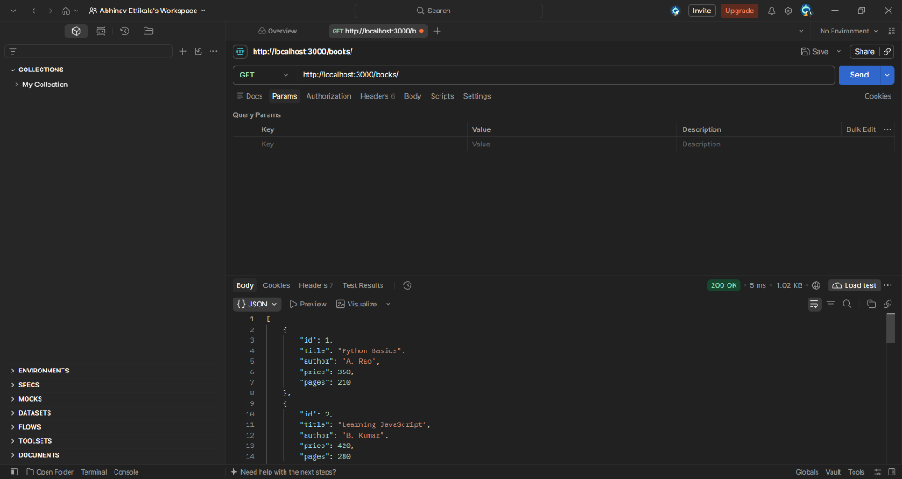
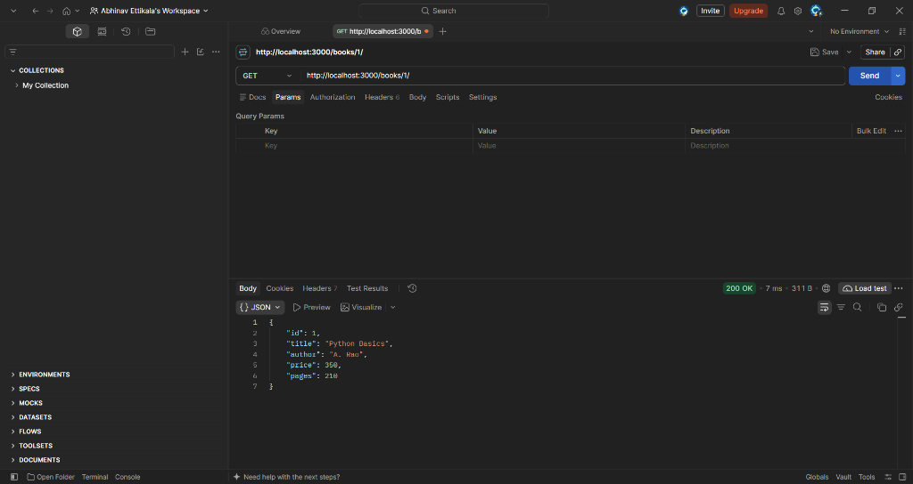
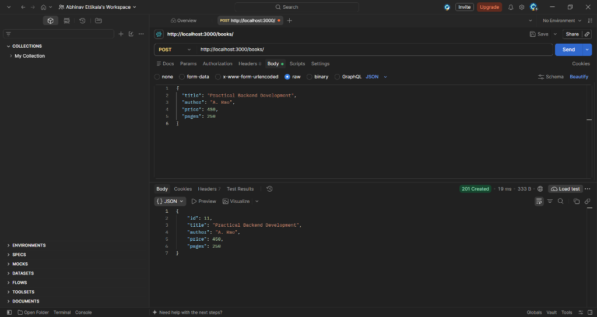
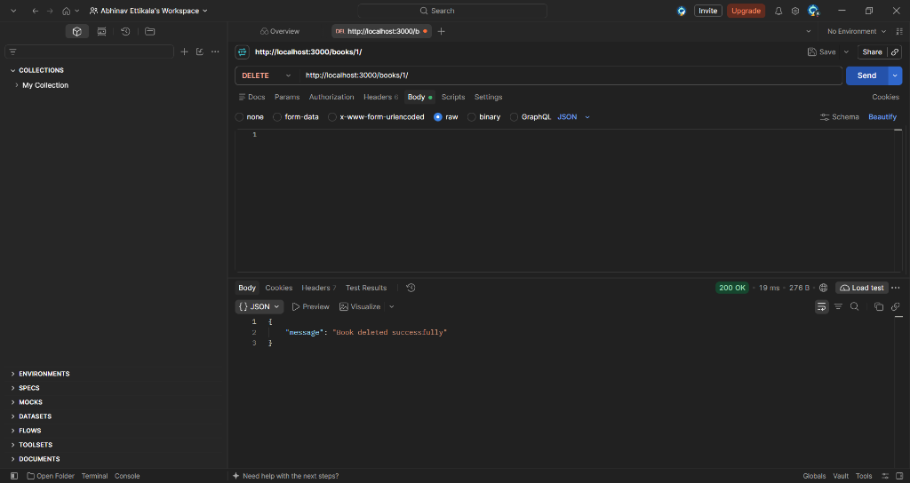

# Lab 02 – SQLite Database and CRUD Routes

## Student Details

- **Name:** Abhinav
- **Registration Number:**   252U1R6065
- **Section:** AIML-2B 

## Live Deployment

Pending deployment. Add your public API URL here. If deployment is not possible, explain the actual reason and include Postman screenshots of every endpoint.

## Aim

Connect an Express server to SQLite and implement Create, Read, Update and Delete operations for books.

## Technologies Used

Node.js, Express.js, SQLite, sqlite, sqlite3, Nodemon and Postman.

## Project Structure

| File | Purpose |
| --- | --- |
| index.js | Express server and five CRUD endpoints |
| bookstore.db | SQLite database with 10 sample books |
| seed.sql | Table definition and 10 fictional sample records |
| package.json / package-lock.json | Dependencies and run commands |
| postman_collection.json | Importable requests for all five endpoints |
| .gitignore | Excludes dependencies, environment files and logs |
| screenshots/ | Add actual Postman screenshots here |

## Database Structure

Database: `bookstore.db`; table: `book`.

| Column | Type | Description |
| --- | --- | --- |
| id | INTEGER PRIMARY KEY | Unique book ID, generated when omitted |
| title | TEXT | Book title |
| author | TEXT | Author name |
| price | INTEGER | Nonnegative price |
| pages | INTEGER | Positive page count |

The included database was generated from `seed.sql` using Python SQLite. For the lab's CLI exercise, open a terminal inside `lab-02` and run:

```bash
sqlite3 bookstore.db
```

At the SQLite prompt:

```sql
.read seed.sql
.headers on
.mode column
SELECT * FROM book;
.quit
```

The seed uses INSERT OR IGNORE, so running it on the supplied database does not duplicate existing IDs. To practice creating and inserting all rows from the CLI, use a new database filename with the same commands. The API always uses `bookstore.db`.

## Installation

Install Node.js 22 or newer and npm. Install the SQLite CLI separately for the CLI exercise.

From the course repository:

```bash
cd lab-02
npm install
```

## Running the Application

Development mode with automatic restarts:

```bash
npm run dev
```

Production mode:

```bash
npm start
```

Open http://localhost:3000/books/. Stop with Ctrl+C. Run only one server on port 3000 at a time.

No environment variables are required locally. Optional `PORT` is read from the host environment and defaults to 3000. No .env file is loaded or required.

## API Endpoints

| Method | Endpoint | Description | Success status |
| --- | --- | --- | --- |
| GET | /books/ | Retrieve all books | 200 |
| GET | /books/:bookId/ | Retrieve one book | 200 |
| POST | /books/ | Add a book | 201 |
| PUT | /books/:bookId/ | Replace all editable fields | 200 |
| DELETE | /books/:bookId/ | Delete a book | 200 |

Unknown books and paths return 404. Invalid IDs, fields or JSON return 400. Unexpected server errors return 500.

### Sample POST / PUT Body

Choose Body → raw → JSON in Postman:

```json
{
  "title": "Practical Backend Development",
  "author": "A. Rao",
  "price": 450,
  "pages": 250
}
```

PUT requires all four fields. Use the ID returned by POST for PUT and DELETE.

## Implementation Details

- initializeDBAndServer() opens and checks the database before starting the server.
- express.json() reads JSON request bodies.
- db.all(), db.get() and db.run() perform asynchronous database operations.
- All SQL accepting values uses ? placeholders.
- Input validation checks strings, integer prices, page counts and IDs.

## Postman Testing and Database Verification

Import `postman_collection.json`. The baseUrl variable defaults to http://localhost:3000. Run GET all and GET one, then POST. Copy the returned ID into the collection's bookId variable before running PUT and DELETE. Change the PUT price to confirm the update.

After each mutation, run this in the SQLite CLI, substituting the returned numeric ID:

```sql
SELECT * FROM book ORDER BY id;
```

POST adds a row, PUT changes that row, and DELETE removes it. Capture actual Postman results and a database view.

## Screenshots – Postman API Testing

### GET – All Books


### GET – One Book


### POST – Add Book


### PUT – Update Book


### DELETE – Remove Book


### SQLite Database
<!--  -->

## Deployment

Configure a Node.js web service with root directory `lab-02`, install command `npm ci`, and start command `npm start`. Use persistent disk storage for bookstore.db if changes must survive restarts or redeployments; ephemeral hosting may reset the database. GitHub Pages cannot run this server.

## Viva Questions

**Why await database calls?** To wait for their results before using the data or sending the response.

**What is SQL injection?** Malicious input that changes SQL logic. Bound placeholders treat input as data instead of executable SQL.

**When is PUT used instead of POST?** POST adds a resource; this API uses PUT to replace the editable fields of an existing book at a known ID.

## Notes

Add problems you actually faced and their solutions. If port 3000 is busy, stop the other server. If installation fails for sqlite3, check your Node.js installation and the package installation error.

Before submission, fill in your details, add actual screenshots and deployment information, and understand the code for the viva. Extract and upload the lab-02 folder alongside lab-01 in your course repository. Include bookstore.db; exclude node_modules and .env.

## Package Validation

JavaScript syntax and SQLite integrity checks passed; the database contains 10 records. Live HTTP tests were not completed in the packaging environment because the sqlite3 native dependency installation did not complete successfully. Run npm install and verify all five endpoints locally in Postman.
